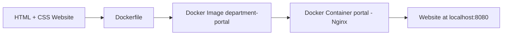

# Departmental Information Portal — Project Report

## 1. Title Page and Group Members

**Project Title:** Departmental Information Portal (Dockerized)

**Course / Activity:** Activity 8

**Department:** Artificial Intelligence and Data Science Engineering

**College:** [College Name]

**Academic Year:** [Academic Year]

**Group Members:**

| Roll No. | Name | Role |
|---|---|---|
| [Roll No. 1] | [Member 1 Name] | Website + Docker |
| [Roll No. 2] | [Member 2 Name] | GitHub + README |
| [Roll No. 3] | [Member 3 Name] | Testing + Screenshots |
| [Roll No. 4] | [Member 4 Name] | Report + PPT + Diagram |

**Guide / Faculty Mentor:** [Faculty Guide Name]

---

## 2. Problem Statement

Every academic department needs a simple way to share information such as its vision and mission, faculty details, the courses it offers, and contact information with students, parents, and visitors. In practice, this kind of information is often scattered across notice boards, printed brochures, or outdated web pages hosted on servers that are difficult to maintain. A departmental information portal addresses this by bringing all of this information together on a single, easy-to-navigate web page.

However, simply building a website is not enough. A website that works perfectly on one laptop may fail to run on another system due to differences in installed software, operating system versions, or missing web server configuration. This is a common and frustrating problem in real-world deployment: "it works on my machine" but not on someone else's. A departmental information portal needs to run consistently across different systems, whether it is a lab computer, a faculty member's laptop, or a cloud server.

Docker solves this problem by packaging the website together with everything it needs to run — in this case, the Nginx web server — into a single, self-contained unit called a container image. Once this image is built, it behaves identically no matter which machine runs it, as long as that machine has Docker installed. This project uses Docker to package the departmental website and its serving environment into a container, so that it can be built once and run reproducibly anywhere.

## 3. Objectives

The specific objectives of this project are:

1. To develop a simple, informative, and visually clean departmental information portal using plain HTML and CSS.
2. To create a Dockerfile that correctly packages the website for deployment using the Nginx web server.
3. To build and tag a Docker image from that Dockerfile.
4. To run the website as a Docker container and make it accessible through a web browser.
5. To verify that the deployed website functions correctly — including after stopping and restarting the container — and to document the entire process, including testing results and troubleshooting steps, so that the work is reproducible by others.

## 4. Software and Hardware Requirements

**Software requirements:**

- Operating System: Windows 10/11 (also works on macOS or Linux)
- Docker Desktop (includes the Docker Engine and CLI)
- A text editor or IDE (e.g. Visual Studio Code)
- A modern web browser (e.g. Chrome, Edge, or Firefox) to view the portal
- Git, for version control, and a GitHub account for hosting the repository
- PowerShell (for running the Windows helper scripts included in this project)

**Hardware requirements:**

- A computer capable of running Docker Desktop (64-bit processor, virtualization support enabled in BIOS/UEFI)
- Minimum 4 GB RAM (8 GB or more recommended for smooth Docker Desktop performance)
- At least 2 GB of free disk space for Docker images and the Docker Desktop installation
- Internet connection, required only for the initial download of Docker Desktop and the `nginx:alpine` base image; the running container itself needs no internet access

## 5. Technologies Used

**HTML5** was used to structure the content of the portal semantically, using elements such as `<header>`, `<nav>`, `<main>`, `<section>`, and `<footer>` so that the page is both readable by browsers and easy for screen readers to interpret.

**CSS3** was used for all styling, including layout, color, typography, and responsiveness. CSS custom properties (variables) were used to define a consistent color palette, and `grid` and `flexbox` were used to lay out the faculty cards, course information, and contact details so that the page adapts cleanly from desktop to mobile widths.

**Docker** was used to containerize the website. Docker allows an application and all of its dependencies to be packaged into a portable image that runs the same way on any machine with Docker installed, removing the "works on my machine" problem entirely.

**Nginx** (specifically the lightweight `nginx:alpine` image) was used as the web server inside the container. Nginx is a fast, widely used, production-grade web server that is well suited for serving static HTML/CSS sites with minimal configuration.

**Git and GitHub** were used for version control and (eventually) for hosting the project source code publicly, enabling collaboration between the four team members and providing a clear history of how the project was built.

## 6. System Architecture / Workflow Diagram

The overall workflow of this project follows a straightforward, linear pipeline, from writing source files to serving the finished website in a browser:

```
HTML + CSS Website → Dockerfile → Docker Image → Docker Container (Nginx) → Website at localhost:8080
```

The equivalent Mermaid flowchart (see `docs/workflow-diagram.md` for the full file) is:



**Explanation of the architecture:**

The process begins with the static website itself — `index.html` and `style.css` — which can be opened directly in a browser during development, with no server required. Once the website is ready, a `Dockerfile` is written that describes, step by step, how to build an image containing that website and a web server capable of serving it. The Dockerfile used in this project starts from the official `nginx:alpine` base image (a minimal Linux image with Nginx pre-installed), then copies `index.html` and `style.css` into Nginx's default web root directory, `/usr/share/nginx/html/`, and finally declares that the container listens on port 80.

Running `docker build` reads this Dockerfile and produces a Docker **image** named `department-portal`. An image is essentially a read-only template or snapshot — it is not running by itself, but it contains everything needed to run the website. Running `docker run` then creates and starts a **container** — a live, running instance of that image — named `portal`. The `-p 8080:80` flag maps port 8080 on the host machine to port 80 inside the container, which is the port Nginx listens on. As a result, visiting `http://localhost:8080` in a browser on the host machine reaches Nginx inside the container, which serves the departmental portal's HTML and CSS files.

Because the image bundles the website together with the exact web server and configuration needed to run it, this entire pipeline can be repeated identically on any other machine that has Docker installed, which directly satisfies the project's goal of reproducible deployment.

## 7. Implementation Steps

The project was implemented in the following order:

1. **Website design and development.** The single-page portal was built first, with sections for Home, About the Department, Faculty Information, Courses Offered, and Contact Information, linked via a sticky navigation bar using anchor links (`#home`, `#about`, `#faculty`, `#courses`, `#contact`). The page was styled with CSS variables for consistent colors, a responsive grid/flexbox layout, and accessibility considerations such as visible focus outlines and sufficient color contrast.
2. **Local verification without Docker.** Before introducing Docker, the website was opened directly in a browser to confirm that the HTML structure, navigation, and styling worked correctly at both desktop and mobile widths.
3. **Writing the Dockerfile.** A minimal `Dockerfile` was created, based on `nginx:alpine`, copying only `index.html` and `style.css` into the Nginx web root and exposing port 80. A `.dockerignore` file was added to exclude documentation, scripts, and version-control files from the Docker build context, keeping the resulting image small and clean.
4. **Building the Docker image.** The image was built and tagged using `docker build -t department-portal .`, run from the project's root folder (the folder containing the Dockerfile).
5. **Running the container.** The image was run as a container using `docker run -d -p 8080:80 --name portal department-portal`, which started Nginx inside the container and exposed it on the host's port 8080.
6. **Verification.** The running website was checked using both `curl -I http://localhost:8080` (expecting an HTTP `200 OK` response) and by opening `http://localhost:8080` directly in a browser, confirming that all five sections of the page rendered correctly.
7. **Version control.** A Git repository was initialized locally (`git init -b main`), and the project files were committed in small, logical steps: website files, Docker-related files, helper scripts, and documentation, each with a clear, imperative commit message.
8. **Testing and documentation.** An automated PowerShell test script (`scripts/test.ps1`) was written to exercise the build, run, access, stop, restart, and log-checking steps described in Section 9, and the results were recorded in `docs/TESTING.md`.
9. **Reporting.** Finally, this report, the presentation outline, and the contributions file were written to document the problem, process, results, and division of work.

## 8. Docker Commands and Screenshots

The table below lists the key Docker commands used in this project, along with an explanation of what each one does. Corresponding screenshots should be captured and placed in `docs/screenshots/` using the filenames listed in `docs/TESTING.md`.

| Command | Explanation | Related Screenshot |
|---|---|---|
| `docker info` | Confirms that the Docker Desktop engine is running and reachable before attempting any build or run commands. | — |
| `docker build -t department-portal .` | Reads the `Dockerfile` in the current directory and builds a new image tagged `department-portal`, copying in `index.html` and `style.css`. | `02-docker-build-success.png` |
| `docker images` | Lists all local Docker images, used here to confirm that the `department-portal` image was created successfully. | `03-docker-images.png` |
| `docker run -d -p 8080:80 --name portal department-portal` | Creates and starts a new container named `portal` from the `department-portal` image, running it in the background (`-d`) and mapping host port 8080 to container port 80. | `04-docker-ps.png` |
| `docker ps` | Lists currently running containers, used to confirm that the `portal` container is up and running. | `04-docker-ps.png` |
| Opening `http://localhost:8080` in a browser | Confirms that the website is reachable and renders correctly through the container. | `01-website-running.png` |
| `docker stop portal` | Stops the running `portal` container without deleting it, used to test that the site becomes unreachable once the container is stopped. | — |
| `docker start portal` | Restarts the previously stopped `portal` container, used to confirm the site becomes reachable again without rebuilding the image. | `05-website-after-restart.png` |
| `docker logs portal` | Displays the Nginx access/error logs from inside the container, used to confirm there are no error-level log entries. | — |
| `docker rm -f portal` | Forcibly removes the `portal` container, used when a container with that name already exists and needs to be replaced. | — |

## 9. Testing Results

The full testing table, troubleshooting notes, and screenshot checklist are maintained in `docs/TESTING.md` and summarized here:

| Test | Expected Result | Status |
|---|---|---|
| Build image | `docker build` completes with no errors | See `docs/TESTING.md` |
| Start container | `portal` container appears in `docker ps` | See `docs/TESTING.md` |
| Open website | HTTP 200 and all 5 sections present | See `docs/TESTING.md` |
| Stop container | Site becomes unreachable after `docker stop` | See `docs/TESTING.md` |
| Restart container | Site reachable again after `docker start` | See `docs/TESTING.md` |
| View logs | No `error`/`emerg`/`crit` log lines | See `docs/TESTING.md` |

The automated script `scripts/test.ps1` performs all six checks in sequence and prints a PASS/FAIL result for each, while leaving the container running afterward so the final state can be inspected manually or screenshotted. Refer to `docs/TESTING.md` for the actual recorded output of each test run, since that file is updated directly from the script's console output rather than duplicated here.

## 10. Challenges Faced and Solutions

A few practical challenges typically arise when containerizing even a simple static website, and the project's documentation was designed to anticipate and address them:

- **Docker Desktop not running.** Docker commands fail silently or with a connection error if the Docker Desktop engine has not fully started. The solution adopted was to always check `docker info` first and wait for Docker Desktop to report that it is running before attempting a build or run.
- **Port conflicts.** Host port 8080 may already be in use by another application or a leftover container, causing `docker run` to fail with a "port is already allocated" error. The solution is to identify and stop whatever is using the port, or to map the container to a different host port (e.g. `-p 8081:80`) if 8080 cannot be freed.
- **Reusing a container name.** Attempting to run a container named `portal` while one with that name already exists (even if stopped) causes a "name already in use" error. The fix is to remove the existing container first with `docker rm -f portal` before creating a new one — this is handled automatically in `scripts/build-and-run.ps1` and `scripts/test.ps1`.
- **Stale content after editing files.** Because a Docker image is a fixed snapshot, editing `index.html` or `style.css` has no effect on an already-running container. The image must be rebuilt and the container recreated for changes to appear, which is easy to forget and was explicitly documented in `docs/TESTING.md`.
- **Build context and working directory.** Running `docker build` from the wrong folder causes Docker to report that it cannot find the Dockerfile or the files it references. Keeping all Docker-related files at the project root and always running build commands from that root avoided this issue.
- **Windows-specific virtualization requirements.** Docker Desktop on Windows depends on WSL2 and hardware virtualization being enabled; on some systems this required enabling virtualization in the BIOS/UEFI and updating WSL2 before Docker Desktop would start correctly.

## 11. Individual Contributions

This project was divided among four members according to the roles described in `docs/CONTRIBUTIONS.md`:

- **Member 1 ([Member 1 Name])** — Website and Docker: designed and implemented the HTML/CSS portal, and wrote and tested the Dockerfile and `.dockerignore`.
- **Member 2 ([Member 2 Name])** — GitHub and README: set up the local Git repository, `.gitignore`, and the project's `README.md` with full setup and usage instructions.
- **Member 3 ([Member 3 Name])** — Testing and screenshots: wrote and ran the automated PowerShell test script, recorded results in `docs/TESTING.md`, and captured the required screenshots.
- **Member 4 ([Member 4 Name])** — Report, presentation, and diagram: authored the workflow diagram, this report, and the presentation outline.

Full details of tasks and deliverables per member are available in `docs/CONTRIBUTIONS.md`.

## 12. Conclusion and Future Scope

This project successfully demonstrates how a simple, static departmental information portal can be built using only HTML and CSS, and then packaged and deployed in a reproducible way using Docker and Nginx. By containerizing the site, the project removes dependency on any particular machine's pre-installed software — anyone with Docker installed can build the same image and run the exact same website, with the same behavior, regardless of their underlying operating system. This directly solves the original problem statement: making a departmental portal that runs consistently across different systems.

Beyond fulfilling the immediate assignment requirements, the project reinforced several practical, transferable skills: writing semantic and accessible HTML, building a responsive layout with modern CSS, authoring a minimal and correct Dockerfile, using core Docker commands (`build`, `run`, `ps`, `stop`, `start`, `logs`), and using Git for structured, incremental version control.

There are several natural directions in which this project could be extended in the future:

- **Docker Compose.** As the project grows — for example, if a backend or database were added later for dynamic content — `docker-compose.yml` could be used to define and manage multiple services (web server, database, etc.) together with a single command.
- **CI/CD integration.** A continuous integration/continuous deployment pipeline (for example, using GitHub Actions) could automatically build and test the Docker image on every push, and optionally publish it to a container registry such as Docker Hub.
- **Dynamic content.** The portal could be extended from a static site into a dynamic one — for instance, using a lightweight backend to manage faculty or course information through a database, rather than hardcoding it into the HTML — while still being served through a containerized environment.
- **HTTPS and custom domains.** In a real deployment, the container could be placed behind a reverse proxy (such as another Nginx instance or Traefik) to provide HTTPS and a proper domain name instead of `localhost:8080`.

Overall, this project provided hands-on experience with the full lifecycle of containerizing a simple web application, from writing the source files to building, running, testing, and documenting a Docker-based deployment.
