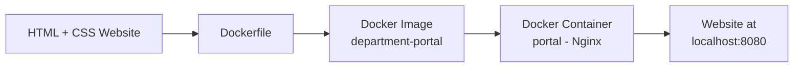

# Workflow Diagram

This diagram shows how the departmental portal moves from source code to a running, accessible website.

## Mermaid Flowchart



## ASCII Diagram

```
 +----------------------+     +--------------+     +----------------------+     +------------------------+     +---------------------------+
 | HTML + CSS Website   | --> |  Dockerfile  | --> |  Docker Image        | --> |  Docker Container      | --> |  Website at              |
 | (index.html,         |     | (build       |     |  "department-portal" |     |  "portal" (Nginx)      |     |  http://localhost:8080   |
 |  style.css)          |     |  instructions)|     |                      |     |                        |     |                           |
 +----------------------+     +--------------+     +----------------------+     +------------------------+     +---------------------------+
```

## Explanation

1. **HTML + CSS Website** — The static site (`index.html`, `style.css`) is written first and tested in a browser directly, without Docker.
2. **Dockerfile** — A `Dockerfile` describes how to package that static site into an image based on `nginx:alpine`, copying the HTML/CSS into Nginx's default web root.
3. **Docker Image** — Running `docker build -t department-portal .` reads the Dockerfile and produces a reusable image named `department-portal`.
4. **Docker Container** — Running `docker run -d -p 8080:80 --name portal department-portal` creates and starts a container named `portal` from that image, with Nginx serving the files inside it.
5. **Website at localhost:8080** — Docker maps container port 80 to host port 8080, so the portal is reachable in any browser at `http://localhost:8080`, on any machine that has Docker installed — no manual web server setup required.
